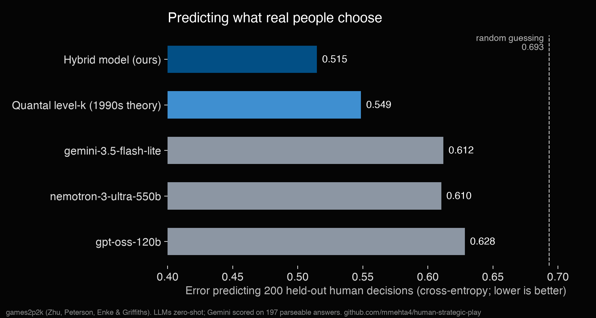

# Human Strategic Play

**Can we predict how real people act when the outcome depends on what others do?** This repository
holds an open benchmark, a family of models, a confirmatory study fixed in advance, and a paper.
It is the research behind [Polymetis](https://windtunnel-5bja.onrender.com), which predicts how
buyers, sellers and bidders respond to prices, fees and auction rules.



## Findings

1. **AI role-play predicts people worse than a 1990s theory.** Asked zero-shot to predict how
   people would choose in 200 held-out two-player games, all three models we tested
   (gpt-oss-120b, Gemini 3.5 Flash Lite, Nemotron 3 Ultra) were significantly worse than quantal
   level-k, a behavioural model from the 1990s (gaps of 0.06–0.08 nats per choice; every 95%
   interval excludes zero). Others report that language models over-reason in strategic settings,
   while most people think only one step ahead.
2. **A hybrid of theory and a neural network predicts best within one dataset.** On games2p2k
   (2,416 decision problems, ~93,000 incentivised choices) a quantal level-k core whose parameters
   a network sets per game, plus a penalised residual, beats every baseline on held-out *strategic
   families*, including an ElementaryNet-style model and a black-box network.
3. **Across studies, structure transfers best.** In a confirmatory test whose protocol was frozen
   and timestamped with OpenTimestamps before scoring ([protocol](docs/evaluation_protocol.md),
   [proof](docs/evaluation_protocol.md.ots)), models trained only on games2p2k were applied to 384
   decision problems from 12 other lab studies. The hybrid beat the neural ElementaryNet-style model
   (by 0.037 nats, 95% CI 0.029–0.046), but plain quantal level-k beat the hybrid (by 0.011). The
   more structural the model, the better it carried over to new populations and game sizes.
   [Full result and notes](docs/h1_results.md).

Paper: [`paper/main.pdf`](paper/main.pdf). All numbers are regenerated from `results/` by
`scripts/make_paper_assets.py`.

### Within-dataset results (exploratory)

| Model | Held-out games: NLL | Held-out strategic family: NLL |
| --- | --- | --- |
| Quantal level-k (best classic theory) | 0.5423 | 0.5428 |
| ElementaryNet-style QLk (reimplementation) | 0.5156 | 0.5185 |
| Black-box MLP | 0.5124 | 0.5203 |
| **Hybrid v0 (structural + residual)** | **0.5123** | **0.5160** |
| Hybrid v1 (any game size) | 0.5132 | 0.5161 |

Lower NLL is better; differences are paired over the same test problems with bootstrap 95% CIs
([full tables](results/RESULTS.md)). These are exploratory: the models were built while looking at
this data, which is why the confirmatory test above was run on different studies.

## Quick start

```bash
cd stage1
python3.12 -m venv ~/.venvs/hsb-stage1 && ~/.venvs/hsb-stage1/bin/pip install -r requirements.txt
source ~/.venvs/hsb-stage1/bin/activate
python -m pytest -q                                # 25 tests, ~8 s
python scripts/run_baselines.py                    # full evaluation, ~40 min on a laptop
```

The dataset downloads automatically from OSF on first use into `data/raw/`.

**Keep the repository and virtual environment outside iCloud-synced folders** (Desktop, Documents).
macOS offloads unused files there to the cloud, and a Python environment with ~27,000 files then
stalls on every import.

## What's here

| Path | What it is |
| --- | --- |
| `hsb/games.py` | Two-player games, Nash equilibria (support enumeration), dominance, best responses |
| `hsb/data/` | Unified record format; games2p2k loader with strategic-family labels (checked against the release's own labels: 0 mismatches); arena loader that turns the arena export into benchmark games of any size |
| `hsb/models/structural.py` | Uniform, Nash with error, logit QRE (homotopy), quantal level-k, Poisson cognitive hierarchy, all by maximum likelihood |
| `hsb/models/neural.py` | Black-box MLP; ElementaryNet-style QLk (our reimplementation); **hybrid v0** (context-dependent quantal level-k + penalised residual); **hybrid v1** (same core, encoder that works for games of any size and treats every action symmetrically) |
| `hsb/eval/` | Cross-entropy, completeness against the sampling-noise floor, paired bootstrap; random / held-out-game / held-out-family splits that keep both sides of a game together |
| `hsb/generator.py` | Procedural mechanisms in 8 families (matrix, beauty contest, ultimatum, trust, public goods, first- and second-price auctions, Bertrand), each with a formal spec, plain-language text and, where finite, a normal form |
| `hsb/llm_free.py`, `hsb/llm.py`, `scripts/run_llm_baseline.py` | Zero-shot LLM baseline on **free tiers** (Groq gpt-oss-120b, Gemini Flash Lite, NVIDIA Nemotron), or Claude when funded; cached and resumable across days |
| `arena/pool.py`, `arena/research_pool.json` | Frozen research pool for the arena's bonus rounds: 12 calibration games copied from the paid dataset and 600 new 3x3 research games |
| `scripts/fetch_wlb_data.sh`, `hsb/data/wlb.py` | Fetches (pinned commit) and reads the 12-study dataset; reads data files only, never runs their code |
| `scripts/h1_confirmatory.py` | The confirmatory transfer test (H1), run once; `scripts/h2_calibration.py` is the paused free-vs-paid test |
| `scripts/run_baselines.py` | Runs every model under every protocol, writes `results/` |
| `scripts/explain_hybrid.py` | What the structural core learns per family (level shares, precision) |
| `scripts/power_analysis.py` | Sample size for the confirmatory study |
| `benchmark/` | Frozen v0 benchmark: problems, descriptions, fixed splits, labels, checksums; `score.py` (with `--save` for leaderboard entries and a hidden-label mode); `submissions/` |
| `site/`, `scripts/build_leaderboard.py` | Static benchmark + leaderboard website, built from results and submissions |
| `arena/` | Arena v1 web app: 20 games in two weekly sets, English / हिन्दी / Español, consent + 18+ gate, measured profile with percentiles and "how you changed", shareable profile card, Gate 2 metrics page, delete-my-data, researcher export. Deploy guide: `arena/DEPLOY.md` |
| `Dockerfile`, `pyproject.toml`, `LICENSE`, `CITATION.cff`, `CONTRIBUTING.md` | Ready to publish as an open-source repository |
| `docs/evaluation_protocol.md` (+ `.ots`) | Frozen, timestamped protocol v3; result in `docs/h1_results.md` |

## Run the arena locally

```bash
ARENA_DB=~/arena-dev.db ARENA_SECRET=dev ARENA_ADMIN_TOKEN=dev python -m arena.app
```

Then open http://127.0.0.1:5055 (metrics: `/admin/metrics?token=dev`). For real players, follow
`arena/DEPLOY.md` (gunicorn in Docker, HTTPS, persistent disk, backups).

## Run the LLM baseline (free tiers)

```bash
python scripts/run_llm_baseline.py --dry-run                                         # see the prompt
python scripts/run_llm_baseline.py --provider groq --model openai/gpt-oss-120b      # needs GROQ_API_KEY
python scripts/run_llm_baseline.py --provider gemini --model gemini-3.5-flash-lite  # needs GEMINI_API_KEY
python scripts/run_llm_baseline.py --provider nvidia --model nvidia/nemotron-3-ultra-550b-a55b  # NVIDIA_API_KEY
```

Keys come from environment variables only; never put them in a file inside this repository.
Answers are cached in `results/llm_cache.jsonl` (git-ignored). If a free daily limit is hit, run
the same command the next day and it resumes.

## Honest limitations

- **Training data is 2x2 only.** Models are trained on games2p2k; the 12-study dataset is used only
  as a test set, and on it the hybrid did not beat quantal level-k.
- **Shares, not counts.** The release gives choice shares per problem; we use the average count
  (~38.7) for the sampling-noise floor.
- **ElementaryNet is a reimplementation,** in the spirit of the AAAI 2026 paper, not the authors'
  code. Treat that row as approximate until checked against their release.
- **Level shares are only partly identified.** Where your own dominant action decides everything,
  level-1 and level-2 predict the same choice, so the split between them there is not meaningful.
- **Exploratory vs. confirmatory.** The games2p2k results are exploratory. The 12-study transfer test
  is confirmatory, with the disclosures in the protocol (section 2).
- **Arena** opponents are drawn from all other real players, so early results can change as the
  player pool grows. The share card is English-only until a Devanagari font is bundled. Hindi and
  Spanish texts need a native speaker's check before launch.

## Data credit

games2p2k: Jian-Qiao Zhu, Joshua C. Peterson, Benjamin Enke, Thomas L. Griffiths, *Capturing the
complexity of human strategic decision-making with machine learning*, https://osf.io/xrvaw/,
CC-BY 4.0.

12-study test set ("all12"), read from github.com/gregdeon/elementarynet at a pinned commit (not
redistributed): Stahl & Wilson (1994, 1995); Costa-Gomes, Crawford & Broseta (1998); Goeree & Holt
(2001); Cooper & Van Huyck (2003); Haruvy, Stahl & Wilson (2001); Haruvy & Stahl (2007); Stahl &
Haruvy (2008); Rogers, Palfrey & Camerer (2009); Costa-Gomes & Weizsäcker (2008); Fudenberg & Liang
(2019); Chui, Hartline & Wright (2023).
